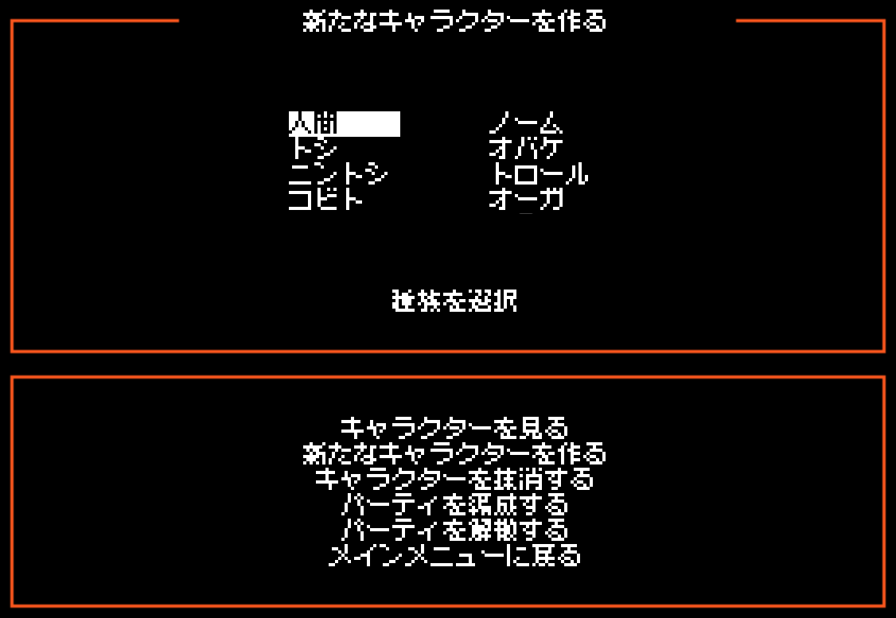

# Deathlord Relorded 日本語化パッチ

1987年の Apple II 用 RPG「Deathlord」を遊びやすくしたリメイク版エミュレーター
**Deathlord Relorded 3.0** を日本語で遊べるようにする、非公式のパッチです。
メッセージ・NPC の台詞・看板・戦闘メッセージ・店や寺院・キャラクター作成・メニューまで日本語にします。
日本語は原作の 7×8 ドットの文字に合わせ、8×8 ドットの「美咲ゴシック第2」で表示します。

- **紹介ページ**: https://higesho.github.io/deathlord-relorded-jp/
- **ダウンロード**: [Releases](https://github.com/higesho/deathlord-relorded-jp/releases/latest) の `DeathlordRelorded_JP_<版>.zip`



## Deathlord Relorded の導入
このパッチは Deathlord Relorded に追加して使います。ゲームのディスクイメージは Relorded に入っています。
1. [itch.io の Deathlord Relorded のページ](https://rikkles.itch.io/deathlord-relorded)から Windows 版の 3.0 テスト版（`deathlord-relorded-windows-3-test.zip`）をダウンロードする
2. ZIP の中身をフォルダごとすべて展開する（`dlrl.exe` の横のフォルダや `SDL3.dll` も必要。`dlrl.exe` だけを移動しない）
3. `dlrl.exe` を起動してタイトル画面が出ることを確かめる（OpenGL 対応のドライバが必要。署名のないテスト版なので、「PC が保護されました」が出たら「詳細情報」→「実行」）

ゲームを始めるには、タイトルで何かキー →「キャラクター設定」でキャラクターを 6 人作る →「パーティを解散する」→「パーティを編成する」で 6 人のパーティを組む → メインメニューで「ゲームを始める」→ Space。
コマンドや呪文の説明は原作のマニュアル（[Deathlord.pdf](https://archive.org/download/Deathlord/Deathlord.pdf)、英語）と、Relorded 同梱の `DOCUMENTATION.md` にあります。

## パッチの使い方
1. Releases から `DeathlordRelorded_JP_<版>.zip` をダウンロードして展開する
2. ZIP の中身（`dlrl_ja.exe`、`assets`、`DLRLAssets`）を Deathlord Relorded のフォルダ（`dlrl.exe` のある場所）にコピーする（上書きはありません）
3. `dlrl_ja.exe` を起動する（**F9** で日本語と原文を切り替え）

元に戻すときは、追加したファイルを削除します。詳しくは ZIP 内の `README_JP.txt` か紹介ページを見てください。

## しくみ
ゲーム本体（6502 のプログラムとディスクイメージ）には手を加えません。
Deathlord Relorded に日本語表示の層を足し、ゲームが表示した英語を読み取って、その上に日本語を重ねます。

- **オリジナル画面**: Apple II のハイレゾ画面のメモリを、ゲームの 7×8 フォントと 1 文字ずつ照合して文字を復元し、
  行をまたぐ文を組み立て直して訳を引きます。タイトル後のメニューやキャラクター作成など、どのプログラムが描いた画面にも効きます。
- **メッセージ欄・看板**: Deathlord Relorded がフックで取り込む 18 桁の行を、同じ方法で文単位にまとめて訳します。
- **数値や名前を含む文**: `PLR #3 HIT!` のような組み立て文は、正規表現のパターンで訳します。
- **Relorded の画面**: メニュー・ダイアログ・インベントリ・CRT 設定などの文字列を辞書で置き換えます。

## 翻訳の規模
| 対象 | 件数 |
|---|---|
| ゲーム内の文（台詞・看板・メッセージ・名前） | 1,449 |
| 数値・名前入りの文のパターン | 49 |
| Relorded の画面の文字列 | 310 |

ディスク上のシナリオと、各場面で吸い出したメモリにある文字列を機械的に照合し、
画面に出る文がすべて訳されていることを確かめています（`tools/check_coverage.py`）。

## リポジトリの中身
| パス | 内容 |
|---|---|
| `patch/` | Deathlord Relorded（上流のコミット `f5c453f`）への変更。日本語表示の層（`Localization.cpp`）、画面の文字の読み取り（`HgrText.cpp`）、UI の置き換えなど |
| `data/ja/` | 翻訳データ。`game.json`（ゲーム内の文。原文はハッシュ値でだけ持つ）と `ui.json`（Relorded の画面） |
| `data/fonts/` | 美咲ゴシック第2 とライセンス |
| `tools/` | 文字列の抽出・照合・検査、配布 ZIP 作成のツール（Python） |
| `trans/` | 用語集・文体の決まり（`glossary.md`） |
| `dist_src/` | 配布 ZIP の説明書 |
| `docs/` | 紹介ページ（GitHub Pages） |

ゲームから抽出した英語の原文は、このリポジトリに含めていません。訳を直すときは、
手元の Deathlord Relorded のディスクイメージから原文を抽出して突き合わせます。
```
python -I tools/extract_text.py "<Deathlord Relorded>/Images/Deathlord PRODOS.hdv" data/ja/game.json text.tsv
（text.tsv の 3 列目を直す）
python -I tools/merge_tsv.py text.tsv data/ja/game.json
```
ゲーム本体のコードは圧縮されているため、システムメッセージや店の文は `dlrl_capture --memory-output` で吸い出したメモリを
`extract_text.py` の後ろに並べると抽出できます。

## ビルド
Visual Studio 2022/2026（C++ デスクトップ開発）、CMake、Git、Python が必要です。
```
tools\build.bat
```
上流の Deathlord Relorded を取得して `f5c453f` に合わせ、`patch/` を当て、翻訳データとフォントを置いてビルドします。
配布 ZIP は `python -I tools/build_release.py <ビルド出力> <出力先> <版>` で作ります。

## ライセンス
- `patch/` と配布する `dlrl_ja.exe` は Deathlord Relorded の改変物で、GNU AGPL v3 に従います（`LICENSE`）。
- 翻訳データとツールも同じく AGPL v3 とします。
- 美咲フォント（門真 なむ）は、自由に利用・改変・再配布できるライセンスです（`data/fonts/misaki-LICENSE.txt`）。

## 免責
本パッチは非公式のファン翻訳であり、Electronic Arts、原作者、Deathlord Relorded の作者とは関係ありません。使用は自己責任でお願いします。
Deathlord © 1987 Al Escudero, David Wong / Electronic Arts. Deathlord Relorded © Rikkles.
